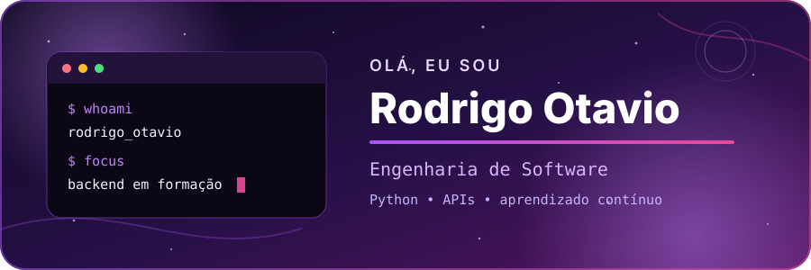

  

  

  Estudante de <strong>Engenharia de Software</strong>, construindo uma base em
  <strong>Python, APIs, bancos de dados e backend</strong>. 
  Busco uma oportunidade de estágio em desenvolvimento ou TI com caminho para programação.

  
  

## `> trajetória`

- **Plásticos do Paraná:** experiência como Jovem Aprendiz em rotinas de Produção e PCP, com apoio a demandas de TI envolvendo estações Windows, rede, domínio, impressoras e sistemas internos como TOTVS Protheus e WMC.
- **Jovens Embaixadores Espro 2026:** desenvolvimento de comunicação, protagonismo, liderança e visão de impacto, conectando pessoas e aprendizados.
- **Engenharia de Software:** formação acadêmica acompanhada de projetos práticos e estudo contínuo de desenvolvimento backend.

## `> projetos em destaque`

| Projeto | O que estou praticando | Tecnologias |
|---|---|---|
| [Lacrei Health API](https://github.com/r-otavio-dev/lacrei-health-api) | API de estudo para profissionais de saúde e consultas, com autenticação, validações e testes | Python, Django REST, PostgreSQL, Docker |
| [Conecta Jovem](https://github.com/r-otavio-dev/conecta-jovem) | Protótipo inspirado no Jovens Embaixadores do Espro, com missões, pontos, portfólio e oportunidades | Next.js, TypeScript, Supabase, PWA |
| [Biblioteca em C](https://github.com/r-otavio-dev/biblioteca-c-projeto-integrador) | Gerenciamento de acervo e empréstimos para um Projeto Integrador de Algoritmos | C, algoritmos, terminal |

> Os projetos mais complexos tiveram apoio de ferramentas de IA. Meu foco é
> entender, testar, modificar e explicar o que publico — sem apresentar
> tecnologias em estudo como domínio avançado.

## `> tecnologias`

  

**Uso em projetos de estudo:** Python, SQL/SQLite, Git/GitHub, HTML, CSS e JavaScript. 
**Em consolidação:** Django REST Framework, PostgreSQL, testes, Docker, Next.js e TypeScript.

## `> plano de carreira`

1. **Agora:** consolidar lógica, Python, Git, SQL, APIs e testes com projetos que eu consiga explicar.
2. **Próximos 12 meses:** conquistar experiência em desenvolvimento, aprender com revisão de código e participar de entregas reais.
3. **Médio prazo:** aprofundar backend, arquitetura, bancos de dados, segurança e automação para construir sistemas úteis.

## `> networking e contato`

Quero aprender em público com honestidade: compartilhar evolução no LinkedIn,
manter projetos bem documentados e participar de comunidades e eventos da área.

- [LinkedIn](https://www.linkedin.com/in/rodrigo-otavio-silvestre-filho/)
- [Portfólio](https://r-otavio-dev.github.io/portfolio/)
- [GitHub](https://github.com/r-otavio-dev)
- [E-mail](mailto:rodrigo.otavio.silvestre@gmail.com)

  

